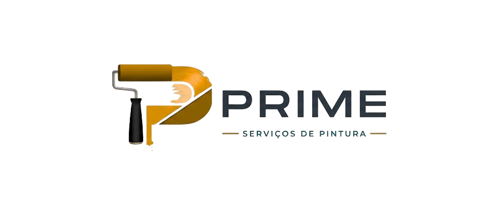

<div align="center">
  

  # 🎨 Prime Pintura — High-Performance Landing Page & AI Agent

  <p align="center">
    <strong>Experiência web cinematográfica com renderização orientada a scroll e assistente de IA conversacional para conversão comercial.</strong>
  </p>

  <p align="center">
    <a href="https://pinturaprime.com.br/" target="_blank">
      
    </a>
    
    
    
  </p>
</div>

---

## 📌 Visão Geral do Projeto

A **Prime Pintura** é uma empresa de pintura residencial e comercial atuante em São Paulo. Este projeto foi concebido para entregar uma **experiência digital de altíssimo padrão visual e técnico**, superando as limitações comuns de páginas de serviços locais através de:

1. **Engenharia de Performance e Animação**: Animação cinematográfica de vídeo acionada pelo scroll do usuário (*scroll-scrubbing*) sem perda de frames e compatível com dispositivos móveis.
2. **Arquitetura Serverless & Inteligência Artificial**: Assistente virtual proprietário (**Flandão**) alimentado pelo **Google Gemini 3.5 Flash**, treinado com *prompt system instructions* especializadas para qualificar leads, sanar dúvidas técnicas sobre alvenaria/tintas e converter diretamente para o WhatsApp comercial.
3. **Zero Dependências Pesadas de Build**: Desenvolvido em JavaScript ES6+ e CSS moderno nativo, alcançando carregamento instantâneo, total conformidade com Core Web Vitals e hospedagem escalável na Netlify.

---

## 🚀 Destaques de Engenharia & Arquitetura

### 1. 🎬 Hero Cinematográfico com Scroll-Scrubbing em `<canvas>`
- **Desafio:** A reprodução direta de tags `<video>` controladas por scroll via JavaScript (`video.currentTime = ...`) sofre com *throttling*, atraso de decodificação de hardware e incompatibilidade severa em Safari iOS.
- **Solução:** Desenvolvido um motor customizado de renderização que pré-carrega frames otimizados em WebP e utiliza uma pipeline de desenho em `<canvas>` de alta resolução (`requestAnimationFrame` com interpolação linear *lerp*). O usuário "controla" a fluidez da tinta na tela conforme rola a página, mantendo 60 FPS consistentes.

### 2. 🤖 "Flandão" — Agente de IA Conversacional Serverless
- **Motor de IA:** Integrado à API REST do **Google Gemini (gemini-3.5-flash)** via Netlify Functions (Node.js 18+).
- **Proteção e Sanitização de Dados:** 
  - Limitação de taxa em memória (*in-memory rate limiting*): 20 requisições/hora e 400/dia por IP para blindagem contra custos e abusos.
  - Validação estrita de CORS e origens permitidas (`https://pinturaprime.com.br`, `http://localhost:8888`).
  - Timeout de execução com `AbortController` (8,5 segundos) e corte rigoroso de payload (últimas 10 mensagens, máx. 500 caracteres cada).
  - Sanitização e injeção no DOM estritamente via `textContent` (prevenção contra ataques XSS).
- **Graceful Degradation:** Em caso de oscilação de conectividade ou indisponibilidade da API, o widget ativa um fallback amigável encaminhando o cliente para o atendimento humano via WhatsApp sem exibir códigos técnicos.

### 3. 🌗 Design System, Acessibilidade e Tema Claro/Escuro
- Tokens de design semânticos centralizados em CSS Custom Properties (`:root` e `[data-theme="light"]`).
- Suporte a `prefers-reduced-motion` para usuários sensíveis a movimento, desativando transições bruscas.
- Cabeçalho com padrão translúcido (*frosted glass*) fixo, preservando contraste visual contínuo sobre animações de vídeo.
- Acessibilidade validada com semântica WAI-ARIA (`role="dialog"`, `role="log"`, `aria-live="polite"`, fechamento por tecla `Escape` e gerenciamento inteligente de foco).

---

## 🛠️ Tecnologias Utilizadas

| Camada | Tecnologia | Propósito / Aplicação |
| :--- | :--- | :--- |
| **Front-end Core** | HTML5 Semântico, CSS3 (Modern Grid, Flexbox, Custom Props) | Estruturação de dados estruturados e layouts fluidos |
| **Linguagem & Lógica** | JavaScript Vanilla (ES6+) | Lógica reativa, renderização de canvas, widget customizado |
| **Reatividade Auxiliar** | [Alpine.js](https://alpinejs.dev/) (~15kB) | Controle leve e declarativo do estado do menu mobile e alternância de tema |
| **Computação Serverless**| Netlify Functions (Node.js) | Backend serverless sem servidor dedicado para consumo seguro da API |
| **Inteligência Artificial**| Google Gemini API (`gemini-3.5-flash`) | Processamento de linguagem natural e atendimento automatizado |
| **Mídia & Otimização** | WebP, WebM, MP4 H.264 | Formatos modernos de compressão de alta densidade visual com baixo peso |
| **SEO & Analytics** | JSON-LD Schema.org, Google Analytics 4 (gtag) | Rastreamento de conversão e indexação geográfica avançada |

---

## 📂 Estrutura do Repositório

```bash
primepintura/
├── assets/                  # Assets estáticos de alta performance
│   ├── frames-hero/         # Frames compactados em WebP para o motor de scroll
│   ├── gallery/             # Fotografias de projetos e acabamentos
│   ├── logo/                # Identidade visual e favicons em múltiplas resoluções
│   └── video/               # Loops de vídeo com camadas de parallax
├── css/
│   └── style.css            # Design tokens, tipografia, grid responsivo e microinterações
├── flandao/                 # Módulo isolado do assistente com IA
│   ├── flandao-widget.js    # Widget em JS puro com histórico em sessionStorage
│   └── flandao-widget.css   # Estilização escopada com suporte a mobile e dark mode
├── js/
│   ├── script.js            # Controladores do canvas, parallax, lightbox e observers
│   └── vendor/              # Alpine.js minificado localmente (zero dependência de CDN externa)
├── netlify/
│   └── functions/
│       └── flandao.js       # Função serverless segura intermediando a Gemini API
├── test/
│   ├── dev-server.js        # Servidor de desenvolvimento local simulando ambiente serverless
│   └── flandao.test.js      # Suíte de testes automatizados unitários do backend
├── .env.example             # Documentação de variáveis de ambiente necessárias
├── .gitignore               # Proteção contra vazamento de credenciais locais
├── index.html               # Página pública única otimizada para SEO
├── netlify.toml             # Regras de build e direcionamento de rotas da Netlify
└── README.md                # Documentação técnica e visão do projeto
```

---

## 🧪 Suíte de Testes Automatizados

O backend da função serverless conta com uma suíte de testes unitários automatizada nativa sem dependências externas (`test/flandao.test.js`), validando:

- [x] Restrição a métodos HTTP não autorizados (`GET 405`).
- [x] Rejeição de requisições com dados vazios ou JSON malformado (`400 Bad Request`).
- [x] Bloqueio e autorização de CORS contra domínios desconhecidos (`403 Forbidden`).
- [x] Mecanismo de contingência para ausência de credenciais (`500`).
- [x] Higienização de tamanho de texto (limite estrito de 500 caracteres por mensagem).
- [x] Envio seguro da chave de API em cabeçalhos HTTP (`x-goog-api-key`), blindando a URL contra vazamento em logs.
- [x] Mapeamento de sobrecarga de cota da IA (`429` do provedor convertido em `503 Service Unavailable`).
- [x] Rate limiting em memória por IP (estrangulamento automático de requisições excessivas).

Para rodar os testes:
```bash
node test/flandao.test.js
```

---

## 💻 Como Rodar o Projeto Localmente

1. **Clone o repositório:**
   ```bash
   git clone https://github.com/BrunoCarvalho07/primepinturanew.git
   cd primepinturanew
   ```

2. **Configure o arquivo de ambiente:**
   Duplique o arquivo `.env.example` para `.env`:
   ```bash
   cp .env.example .env
   ```
   Insira sua chave obtida gratuitamente no [Google AI Studio](https://aistudio.google.com/apikey):
   ```env
   GEMINI_API_KEY=sua_chave_aqui
   GEMINI_MODEL=gemini-3.5-flash
   FLANDAO_ATIVO=sim
   ```

3. **Inicie o servidor de desenvolvimento:**
   ```bash
   node test/dev-server.js
   ```
   Ou via Netlify CLI:
   ```bash
   npx netlify-cli dev --offline
   ```
   Acesse no navegador: **`http://localhost:8888`**

---

## 📈 Métricas & Resultados de Negócio

- **Taxa de Conversão:** Presença de CTAs de ação rápida, botão flutuante persistente e redirecionamento de leads qualificados pelo Flandão diretamente para o WhatsApp comercial (`(11) 91341-5626`).
- **Prova Social Integrada:** Avaliações reais de clientes com pontuação **5.0 ★★★★★** sincronizadas e com link direto para o perfil verificado da empresa no **Google Maps**.
- **SEO Local:** Metadados estruturados JSON-LD declarando `areaServed` para os principais distritos de São Paulo (Guilhermina, Tatuapé, Mooca, etc.).

---

## 👨‍💻 Autor

Desenvolvido por **Bruno Carvalho**  
- **LinkedIn:** [linkedin.com/in/bruno-carvalho-silvaa](https://www.linkedin.com/in/bruno-carvalho-silvaa)  
- **GitHub:** [@BrunoCarvalho07](https://github.com/BrunoCarvalho07)  
- **Website Oficial:** [pinturaprime.com.br](https://pinturaprime.com.br)
